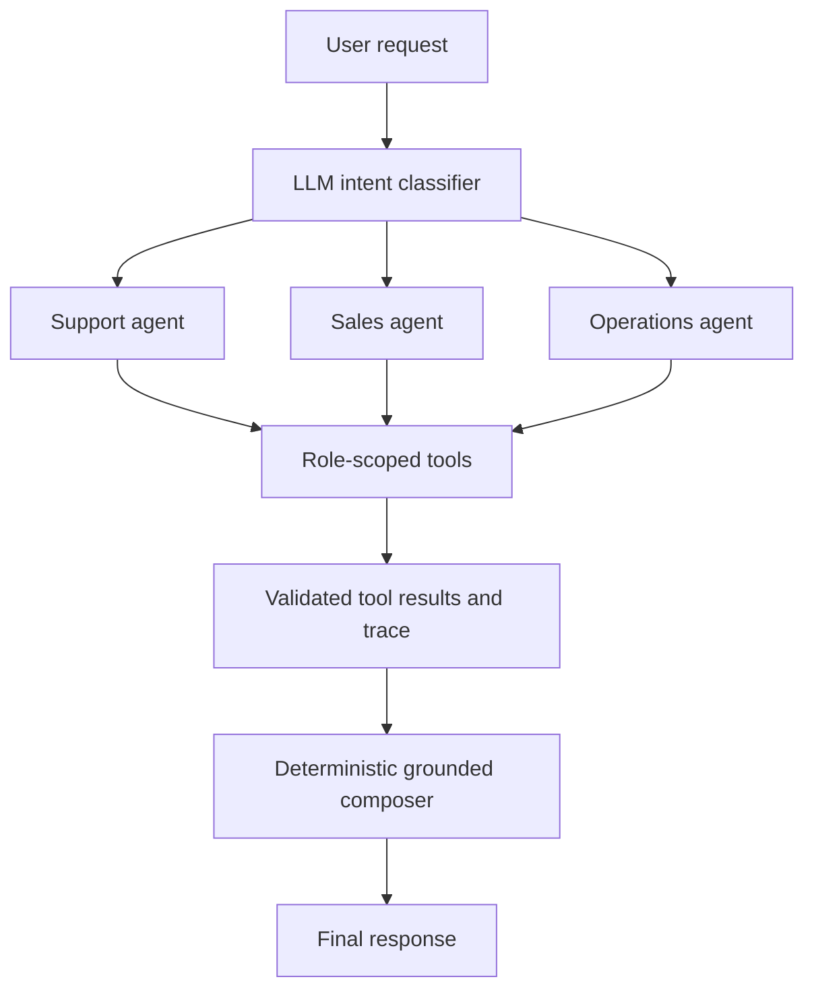

# Multi-Agent LLM Orchestrator

**Local AI with Ollama and Strata**

An independent, AI-assisted Node.js demonstration of multi-agent
LLM orchestration using fictional business records.

## Overview

The application routes user requests to specialist agents:

- **Support:** Order status and customer requests
- **Sales:** Product pricing and quotation previews
- **Operations:** Inventory-related requests

The LLM handles intent classification and specialist tool selection.
Role-scoped tools retrieve fictional business data.

Final factual responses are assembled deterministically from
validated tool outputs. This reduces the risk of a language model
introducing unsupported prices or contradictory order information.

## Architecture



## Local model support

The same application has been tested with:

| Runtime | Model |
|---|---|
| Ollama | Llama 3.2 |
| Strata | Qwen3.8-Flash-Next Gyro-S |

Actual inference depends on the model and runtime installed locally.

### Option A: Ollama

Start Ollama with an already installed Llama 3.2 model.

PowerShell:

```powershell
$env:OPENAI_BASE_URL = "http://127.0.0.1:11434/v1/chat/completions"
$env:OPENAI_API_KEY = "ollama"
$env:OPENAI_MODEL = "llama3.2:latest"
$env:PORT = "3002"
npm start
```

### Option B: Strata

Start Strata and load the locally available model.

Example configuration from the tested desktop installation:

```powershell
$env:OPENAI_BASE_URL = "http://127.0.0.1:47831/v1/chat/completions"
$env:OPENAI_API_KEY = "local"
$env:OPENAI_MODEL = "gyro-gyro-s"
$env:PORT = "3004"
npm start
```

The Strata port and model ID may differ between installations.
The placeholder API keys are for unauthenticated local endpoints only.

Open the matching localhost port in your browser.

## Verification

```powershell
npm run check
npm test
```

The standalone project passed 22 automated tests in the
November 2026 local verification.

Observed local workflows included:
- Support order lookup
- Sales quote creation and price lookup
- Combined Support + Sales routing
- Successful function calls
- Invalid SKU and quantity normalization
- Failed-tool safeguards
- Grounded response construction

These are functional demonstrations, not production reliability
benchmarks.

## Example

Request:

> Check fictional order ORD-1001 and prepare a quote preview
> for 10 units of SKU-A100.

Verified synthetic data:

- Order status: delayed
- Delivery: pending carrier update
- Unit price: $24 USD
- Preview total: $240 USD

No real order was accessed and no commercial transaction was created.

## Important limitations

- Demonstration only; not a production deployment
- Fictional business data only
- No real ERP, CRM, inventory, or payment integrations
- Local inference performance depends on hardware
- Only a limited set of workflows has been evaluated
- LLM classification and tool selection are not infallible

## Development approach

The system was developed through AI-assisted coding and iterative
testing based on an independently conceived orchestration idea.

The focus is on integrating local LLM inference, validating tool
arguments, controlling agent permissions, observing execution,
and grounding final responses in tool results.

## License

A license has not yet been selected.