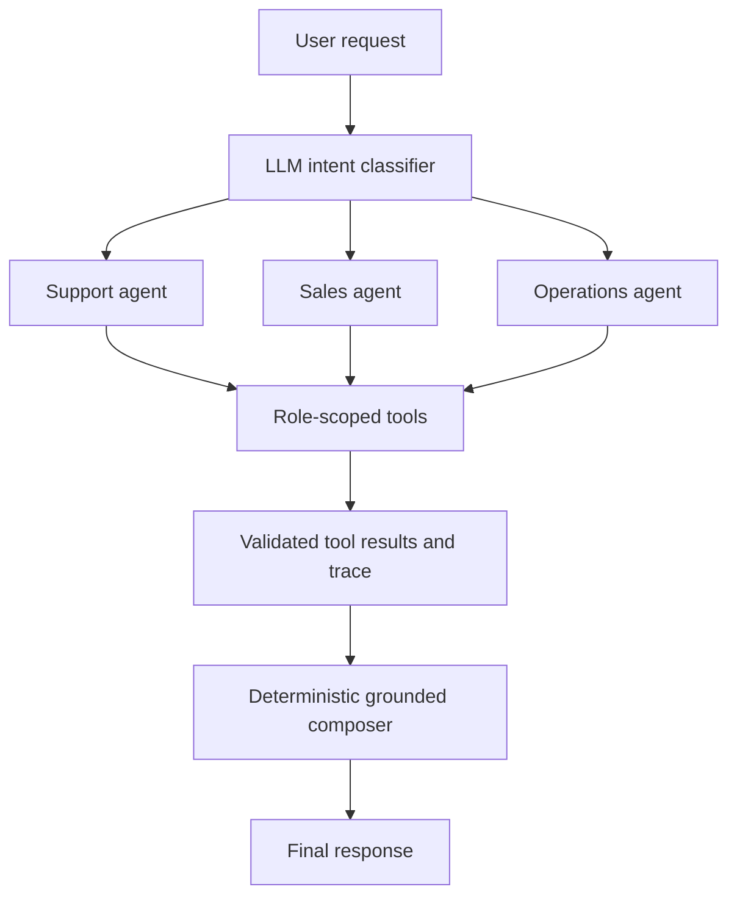

# Multi-Agent LLM Orchestrator

**Local AI with Ollama and Strata**

An independent, AI-assisted Node.js demonstration of multi-agent
LLM orchestration using fictional business records.

## Overview

The application routes user requests to specialist agents:

- **Support:** Order status and customer requests
- **Sales:** Product pricing and quotation previews
- **Operations:** Inventory-related requests

The LLM handles intent classification and specialist tool selection.
Role-scoped tools retrieve fictional business data.

Final factual responses are assembled deterministically from
validated tool outputs. This reduces the risk of a language model
introducing unsupported prices or contradictory order information.

## Architecture



## Local model support

The same application has been tested with:

| Runtime | Model |
|---|---|
| Ollama | Llama 3.2 |
| Strata | Qwen3.8-Flash-Next Gyro-S |

Actual inference depends on the model and runtime installed locally.

### Option A: Ollama

Start Ollama with an already installed Llama 3.2 model.

PowerShell:

```powershell
$env:OPENAI_BASE_URL = "http://127.0.0.1:11434/v1/chat/completions"
$env:OPENAI_API_KEY = "ollama"
$env:OPENAI_MODEL = "llama3.2:latest"
$env:PORT = "3002"
npm start
```

### Option B: Strata

Start Strata and load the locally available model.

Example configuration from the tested desktop installation:

```powershell
$env:OPENAI_BASE_URL = "http://127.0.0.1:47831/v1/chat/completions"
$env:OPENAI_API_KEY = "local"
$env:OPENAI_MODEL = "gyro-gyro-s"
$env:PORT = "3004"
npm start
```

The Strata port and model ID may differ between installations.
**Keep Strata running and its model loaded** while using this application.
Check the local `/v1/models` endpoint before starting Studio; a stopped
or restarted Strata process may no longer listen on the previously used port.
The placeholder API keys are for unauthenticated local endpoints only.

Open the matching localhost port in your browser.

## Local inference reliability

Local model runtimes can be memory-constrained. The application supports an
optional **sequential** specialist execution mode to avoid running two model
requests against the same local runtime concurrently.

PowerShell example for Strata (start Strata and load your model first):

```powershell
$env:OPENAI_BASE_URL = "http://127.0.0.1:47831/v1/chat/completions"
$env:OPENAI_MODEL = "gyro-gyro-s"
$env:OPENAI_API_KEY = "local"
$env:AGENT_EXECUTION_MODE = "sequential"
$env:MODEL_TIMEOUT_MS = "300000"
$env:PORT = "3004"
npm start
```

| Setting | Default | Notes |
|---|---|---|
| `AGENT_EXECUTION_MODE` | `parallel` | Set `sequential` for memory-constrained local inference |
| `MODEL_TIMEOUT_MS` | `120000` | Per-request timeout in milliseconds; allowed range 1,000–600,000 |
| `OPENAI_BASE_URL` | OpenAI chat-completions URL | For local use, provide the full local `/v1/chat/completions` URL |
| `OPENAI_MODEL` | `gpt-4o-mini` | Set this to the model ID returned by your local inference server |

**Important:** a 300-second timeout applies to each individual model request,
not to the overall multi-agent workflow. Sequential execution can increase
total latency; it is an option for stability rather than a speed optimization.
A configured LLM provider is not by itself proof of a successful inference.

The trace records which specialists were selected, whether they invoked a
tool, tool results, and sanitized specialist failures. When a specialist
doesn't execute a required tool, the grounded composer reports that the
corresponding data could not be verified rather than inventing facts.
Tool-call consistency still varies between models and prompts.

## Verification

```powershell
npm run check
npm test
```

The standalone project passed **27 automated tests** in the
November 2026 local verification, including configurable timeouts,
sequential agent dispatch, specialist failure tracing, and tool-grounding safeguards.
The GitHub Actions workflow also runs the syntax check and regression suite.

A live local Strata run on November 14, 2026 selected Support + Sales,
successfully executed `lookup_order`, `draft_quote`, and `get_price`,
and returned the synthetic order status and $240 preview quote using
the deterministic grounded composer. That particular run took approximately
217 seconds on memory-constrained laptop hardware. This is a demonstration,
**not a latency benchmark or proof of reliability across different prompts**.

Observed local workflows included:
- Support order lookup
- Sales quote creation and price lookup
- Combined Support + Sales routing
- Successful function calls
- Invalid SKU and quantity normalization
- Failed-tool safeguards
- Grounded response construction

These are functional demonstrations, not production reliability
benchmarks.

## Example

Request:

> Check fictional order ORD-1001 and prepare a quote preview
> for 10 units of SKU-A100.

Verified synthetic data:

- Order status: delayed
- Delivery: pending carrier update
- Unit price: $24 USD
- Preview total: $240 USD

No real order was accessed and no commercial transaction was created.

## Important limitations

- Demonstration only; not a production deployment
- Fictional business data only
- No real ERP, CRM, inventory, or payment integrations
- Local inference performance depends on hardware
- Only a limited set of workflows has been evaluated
- LLM classification and tool selection are not infallible

## Development approach

The system was developed through AI-assisted coding and iterative
testing based on an independently conceived orchestration idea.

The focus is on integrating local LLM inference, validating tool
arguments, controlling agent permissions, observing execution,
and grounding final responses in tool results.

## License

A license has not yet been selected.